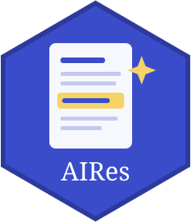

# AIRes 

Website: <https://pablosancheznunez.com/AIRes/>

How the use of artificial intelligence in research is **declared** and **governed**: AI-use disclosures in articles and AI policies of journals, publishers, funders and institutions.

Status: **prototype**. The rules are tested on synthetic examples; they have not yet been validated against a hand-coded sample of real articles and policies. Part of the [metascience](https://github.com/pablosancheznunez/metascience) ecosystem.

## What is measured, and what is not

Every result has `ai_use_basis = "declared"`: it reports what authors or policies *say*. The package **does not** estimate whether a text was written with AI, because automated AI-text detection is not reliable evidence of authorship. So:

- an article with no disclosure is reported as "no disclosure found", never as hidden use;
- a declaration of **non-use** ("no AI tools were used") is recorded apart from the absence of any statement;
- a text that cannot be read is `unverifiable`, and a policy dimension the text does not address is `not_stated`, never "no".

For logging and disclosing AI use inside your own project, use [aitrail](https://github.com/pablosancheznunez/aitrail).

## Disclosures in articles

```r
# install.packages("remotes")
remotes::install_github("pablosancheznunez/AIRes")
library(AIRes)

d <- air_detect_disclosure(texts, id = dois)
d[, c("id", "disclosure_statement", "use_declared", "non_use_declared", "tools", "purposes")]
air_summarise(d, group = journal)    # shares among readable texts, with Wilson intervals
```

The detector reports these indicators:
- an AI-use statement, a declaration of use or of non-use;
- whether human oversight is stated;
- the tools named (19 in `air_tools()`);
- the purposes declared: language editing, translation, drafting, coding, data analysis, literature work and images (`air_purposes()`).

Each result comes with the sentences behind it, in English and Spanish, with rules at version 1.0.0. Both dictionaries can be extended.

## AI policies

```r
coded <- air_code_policy(policy_texts, id = journal_names)
air_compare_policies(coded)
```

The codebook (`air_policy_codebook()`, version 1.0.0) has ten dimensions:
- AI cannot be an author;
- disclosure required, where it goes and the tool details asked for;
- language editing allowed; content generation restricted; images restricted;
- AI use by reviewers restricted; confidentiality;
- authors remain responsible.

Automatic coding is a first pass. A person should check the evidence of each `stated` result and a sample of the `not_stated` ones before publishing.

## License

MIT.
